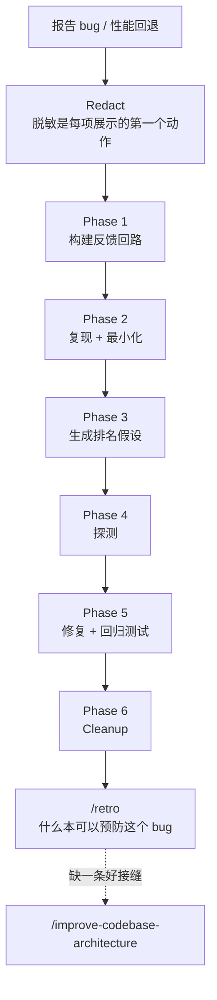

# 工作流：Bug 修复

> **适用**：东西坏了：某功能报错、失败、变慢了，包括间歇性 bug 和两个已知良好状态之间的回归。
> **上游入口**：`/diagnosing-bugs`（模型自动调用，agent 会在你说"diagnose / debug"或报告损坏时自己拉起）｜返回 [推荐工作流总览](./推荐工作流.md)

---

## 流程

---

## 第 0 步：脱敏（Redact）

**这是贯穿全程的第一个动作，不是可选项。** 这个技能会让 agent 展示命令、输出和抓取的产物，所以凡要展示任何东西，先把密钥写成 `<REDACTED>`。

- 构造循环时针对**环境变量**取值，让凭证留在环境里，而不是出现在你展示的内容中。
- 抓取产物（HAR、日志转储、core dump）自带 auth header，只引用携带信号的那些行。
- 脱敏后的输出不足以诊断时，明说并向用户索要脱敏后的产物。

---

## Phase 1：构建反馈回路（核心，其余都是机械的）

**这是整个技能的心脏。** 目标是得到**一条命令**，它满足四个条件：红得了、确定性、够快（秒级）、可无人值守运行。完成标准是：你能说出这条命令，且已经**至少跑过一次**并展示其（脱敏后的）调用与输出。

按优先级尝试 10 种方式：失败测试 > curl 脚本 > CLI 对比 > 无头浏览器 > 重放 trace > 一次性 harness > 属性 / fuzz > 二分 > 差分 > 人机协作脚本。

- **非确定性 bug** 的目标是**提高复现率**，不是完美复现。
- 人只在 `scripts/hitl-loop.template.sh` 里进场。注意其中的 `capture` 会把值回打到终端，所以登录时获取观测值仍应作为 `step`。

> **这个技能要防的核心失败**：在这样一条命令存在之前就埋头读代码建理论。没有反馈回路的"分析"只是在生产叙事。

---

## Phase 2：复现 + 最小化

先确认复现的是**用户描述的失败模式**，而不是附近的其他失败。然后每轮只裁掉一个元素并重跑循环，直到每个剩余元素都不可删。

---

## Phase 3：假设

测试任何假设之前，先生成 **3-5 个排名假设**。每个必须**可证伪**，形如"如果 X 是原因，那么改变 Y 将让 bug 消失"。测试前先给用户看。

---

## Phase 4：探测

每个探针都要对应 Phase 3 的某条预测，**每次只改一个变量**。优先用 debugger / REPL。所有 debug log 加唯一前缀（如 `[DEBUG-a4f2]`），以便一次 grep 清干净。

性能问题先建基线测量，再二分。

---

## Phase 5：修复 + 回归测试

**先写回归测试，再修复。** 但必须有**正确的接缝**：测试要在调用点复现真实 bug 模式。接缝太浅只会给出虚假信心。**没有正确接缝时，这本身就是一条发现**，值得单独说。

靠变异代码或夹具强制造红灯时，先 `diff` 一份原始副本**证明变异确实落地**，再相信那个红灯。

---

## Phase 6：Cleanup

纯清理清单：原 repro 不再复现、回归测试通过（或记录"无接缝"）、所有 `[DEBUG-...]` 已删、临时原型已删或移到明确标记的调试位置、正确的假设写进 commit / PR message。

> 这一步**不再**包含向 `/improve-codebase-architecture` 的事后交接（那来自一个自主、常无人值守的流程，没有人类能接住失败的调用）。改由主流程在修复落地后跑 `/retro` 完成。

---

## 修复之后：`/retro`

修复落地后，在**同一会话**跑 `/retro`，问一个问题：**什么本可以预防这个 bug？**

如果结论是"缺一条好接缝"，才去 `/improve-codebase-architecture`。不要一修完就自动跳到架构扫描。

---

## 前置习惯

探索代码库时，先读 `GLOSSARY.md`（若存在）以建立清晰心智模型，并查看所涉区域的 ADR。用项目的领域语言思考，不要用通用术语猜。
