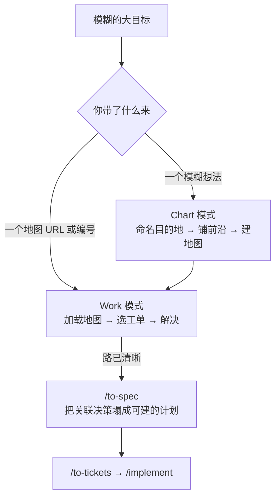

# 工作流：大型规划

> **适用**：目标庞大模糊，从这里到**目的地**的路还看不清，一个 agent 会话装不下。比如制定一份 spec、锁定一系列决策、规划一次数据迁移。
> **上游入口**：`/wayfinder`（用户手动调用）｜返回 [推荐工作流总览](./推荐工作流.md)

---

## 它解决什么问题

普通会话的失败方式是：想法太大，一个窗口装不下，于是你在第 40k token 处已经忘了第 3k token 处决定了什么。

wayfinder 的做法是**把"路还看不清"这件事本身变成制品**：不假装能一次想清楚，而是在 issue tracker 上维护一张**决策工单地图**，逐个解决工单，直到通往目的地的路径清晰为止。

---

## 流程

---

## 核心概念

### 决策工单（decision ticket）

工单的**正文就是一个问题**，它的解答是**一个决策**，而不是一片待建的实现切片。术语建立后 "ticket" 仍是日常用词。

大小对齐一个 **100K token** 的 agent 会话。

### 地图（Map）

tracker 上带 `wayfinder:map` 标签的单个 issue，是唯一规范制品。它是**索引不是仓库**：只列出已做的决策并指向承载细节的工单，**从不重述**。

正文含五节：Destination（目的地）、Notes、Decisions so far（已关闭工单一节一条，gist + 链接）、Not yet specified（战争迷雾）、Out of scope。

### 前沿（frontier）

开放、未阻塞、未认领的子工单。当某张工单的所有阻塞者都已关闭，它即**未阻塞**；前沿就是这些工单的集合。Work 模式里用户没指定时，取**前沿第一张**。

### 战争迷雾（fog of war）

地图**刻意不完整**。看得见还说不清的问题写进 Not yet specified。判定标准是**现在能否精确说出问题**（不是能否回答）。解决一张工单会清掉它前方的雾，把新变得可表述的东西**一次一张**毕业成工单。

超出目的地的不是雾，而是 out of scope，写进独立小节，永不毕业。

---

## 两种调用模式

### Chart：用户带一个模糊想法来

1. **命名目的地**
2. **再次 grill，但广度优先地铺前沿**。若这一步没翻出任何雾，说明你不需要地图，**停下问用户想怎么走**
3. **建地图**
4. **把现在能指定的工单建成子 issue**。**第二遍**才接阻塞边和交叉引用（issue 需要先有 id，占位的 `#<n>` 会自动链到无关 issue）
5. **为每张 research 工单并行派 subagent 调 `"research"`**。发现落在 throwaway 的 `research/<name>` 分支上并留上下文指针，**推分支但不开 PR**，它永不合并，绘图也不因此停下
6. **停下**。绘图是一个会话的工作

### Work：用户带一个地图 URL 或编号来

1. 加载地图的低分辨率视图
2. 选工单（用户没指定就取前沿第一张）并**先认领**，会话的第一个动作就是把它 assign 给自己
3. 按标签类型解决，按需 zoom
4. **记录结论**：发解决评论、关闭 issue、往 Decisions so far 追加一条上下文指针
5. 新增工单（先建后接）并毕业已可表述的雾

---

## 四种工单类型

| 类型 | 方式 | 怎么解决 |
|---|---|---|
| **Research** | AFK | 调 `"research"` 由 subagent 解决，调研一手资料并产出带引用的 Markdown |
| **Prototype** | HITL | 调 `"prototype"` 做个便宜粗糙可反应的实物 |
| **Grilling**（默认） | HITL | 对话，调 Skill 工具两次 `"grilling"` 与 `"domain-modeling"` |
| **Task** | HITL 或 AFK | 决策前必须先做的手工活。它**做**而不**决**，靠解锁决策挣得位置 |

> **调研工单是"一次会话一个工单"的唯一例外。** 绘图会话会为每张 research 工单各拉起一个 subagent 并行烧掉。

---

## 铁律与易错

| 铁律 | 为什么 |
|---|---|
| **一个会话最多解决一张工单** | 除了 research 工单，那是唯一例外 |
| **绝不打 triage 标签** | 它们是决策，不是实现工作 |
| **不要占位引用** | `#<n>` 会自动链到无关 issue，所以阻塞边必须第二遍才接 |
| **不要开调研 PR** | `research/<name>` 分支推上去就好，永不合并 |
| **按名字引用，不用裸 id** | 在人类阅读的一切内容里只叫它的名字；id 和 URL 包在名字里面 |

### 两个高频易错

1. **过度伸手**：wayfinder 比单次 grill 更慢更密，只留给真正装不进一个会话的想法。范围清楚的功能该去 `/grill-with-docs`。
2. **在交接处迷路**：地图清晰后要**交接**，不自己建。并回主流程的 `/to-spec`，而不是把地图直接接进 `/implement`。只有确实变小的努力才直通 `/implement`。

> 把地图直接接进 `/implement` 会**跳过塌缩**：`/to-spec` 的工作就是把地图的关联决策塌成一份可建的计划，这一步丢了，关联细节也跟着丢。

---

## 默认只规划，不做

wayfinder 默认**只规划**。每张工单解决一个决策，地图在"路已清晰、动手前再无可决"时完成。想直接干活的冲动通常说明你已到地图边缘、该交接了。某个 effort 可在其 Notes 里覆盖这一点，把执行带进地图。
