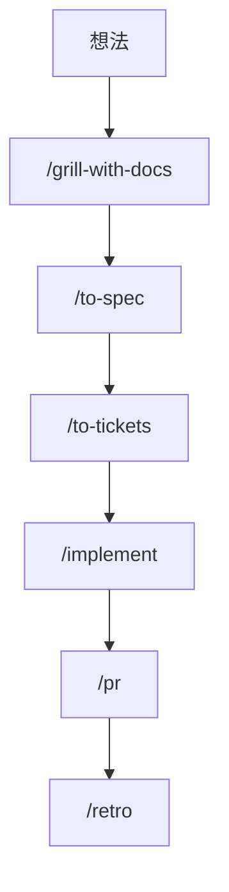

# 工作流：日常开发

> **适用**：把一个新功能或新想法，从模糊的念头变成合并进 main 的代码。这是整套体系的主路径。
> **上游入口**：`/grill-with-docs`（在**工作目录**里才用它）｜返回 [推荐工作流总览](./推荐工作流.md)

---

## 流程

---

## 分步详解

### 1. `/grill-with-docs`：磨砺想法，建立共享语言

**做什么**：一边拷问，一边把学到的领域知识沉淀成 `GLOSSARY.md` 和 ADR。它跑的是 `/grilling` 原语，但**有状态**，讨论的成果会留在仓库里。

**为什么是它而不是 `/grill-me`**：两者跑同一个原语，区别只在于**你是否在一个工作目录里**。在工作目录就用 `/grill-with-docs`，因为它留痕；否则用 `/grill-me`。

**产出**：一个被拷问过的想法 + 一份开始生长的 `GLOSSARY.md`。

**陷阱**：想法还不清楚就想直接开写。拷问的目的就是让它变清楚，跳过这一步会把模糊带进 spec，再带进代码。

---

### 2. `/prototype`（可选）：需要可运行答案时才用

**什么时候插进来**：讨论中冒出一个**只有跑起来才能回答**的问题（这个交互手感对吗、这个状态机转得对吗）。这时经 `/handoff` 进出 `/prototype`。

**产出**：一个**单个自包含的 HTML 文件**，非开发者双击就能打开。它留在从 main 切出的 throwaway 分支 `prototype/<name>` 上作为可运行的证据，并在实现 issue 上留一个上下文指针。

**陷阱**：把原型当成要保留的代码。HTML 外壳是可丢弃的，只有纯逻辑模块才可能提升进真实代码；答案（结论 + 问题）落在 issue、ADR 或 commit 里。

---

### 3. `/to-spec`：把讨论综合成规格

**做什么**：**不采访你**，直接综合已有对话和对代码库的理解，按模板写一份 spec 发布到 issue tracker，打上 `ready-for-agent` 标签。

spec 模板包含：Problem Statement、Solution、User Stories、Implementation Decisions、Testing Decisions、Out of Scope、Further Notes。术语一律用 `GLOSSARY.md` 的词汇。

**这里会跟你确认一件事**：将要测试这个功能的**接缝**（seam）。优先现有接缝、尽量取高层，新接缝越少越好，理想数量是 1。

**陷阱**：spec 里写具体文件路径和代码片段。Implementation Decisions 只放决策，不放在哪写；唯一例外是原型产出的片段（状态机、reducer、schema、类型形状）比散文更精确时才内联，并注明来自原型。

---

### 4. `/to-tickets`：拆成垂直切片工单

**做什么**：把 spec 拆成一组 **tracer-bullet 式垂直切片**。每个切片是一条窄但**完整**的端到端路径（贯穿 schema、API、UI、测试各层），完成即可独立演示，大小适合放进一个**全新的上下文窗口**。

每个工单写明**阻塞边**。发布后按**前沿**推进：任何阻塞者已全部完成的工单都可以开工；纯线性链就是从上到下。

**本地 markdown tracker 的形态**：`.scratch/<feature-slug>/issues/<NN>-<slug>.md`，**一文件一工单**，从 `01` 按依赖序编号。绝不是一个合并的 `tickets.md`。

**关于宽幅重构**：改列名、改共享符号类型这类机械改动会扇向整个代码库，没有垂直切片能落绿。此时按 **expand–contract** 排序：先 expand 在旧形式旁加新形式，再按影响面分批迁移、每批一个工单且被 expand 阻塞、逐批保持 CI 绿，最后 contract 删旧形式。

**这一步会跟你确认**：编号列表里每个工单的标题、Blocked by、以及它交付的端到端行为，问粒度是否合适、阻塞边是否正确，迭代到批准才发布。

---

### 5. `/implement`：逐工单 TDD 驱动实现

**做什么**：每个工单配一个**全新上下文窗口**。尽可能调用 `"tdd"`，在预先约定的接缝处一个红绿切片一个红绿切片地推进；定期跑类型检查、定期跑单个测试文件，最后跑一次完整测试套件。完成后调用 `"code-review"` 做双轴审查（Standards + Spec），再把工作提交到当前分支。

**工单之间 `/clear`**：一个工单做完就清掉，下一个工单用干净窗口开始。这是上下文卫生最自然的落点，见 [阶段边界](./工作流-阶段边界.md)。

**什么时候改走 `/implement-spec`**：工单多且彼此独立时。它把工单读作**任务图**，在就绪的前沿上于各自 worktree 中并行跑 implementer subagent，全部落到**一条集成分支**，最后以 `code-review` 收尾。目标现在是集成分支而不是 PR。

**单会话捷径**：范围小到不需要 spec 和工单时，直接在当前上下文里 `/implement`，跳过第 3、4 步。

---

### 6. `/pr`：塑造 PR 正文

**模型自动调用**，收尾时 agent 会自己拉起它。PR 正文的形状是：摘要用**能讲清改动的最小可视化**（伪代码、调用树、文件树、Mermaid、diff），然后是证明它生效的**前后证据**，最后是**合并危险性判断**（单向门还是双向门 + 爆炸半径）。

---

### 7. `/retro`：收口，改的是环境

**做什么**：回顾本次会话。它改的是 **agent 的环境**而不是代码：什么本可以预防这个问题、哪条指令该进 `CLAUDE.md`、哪个技能该补一条规则。

**要求**：`/retro` 要在它回顾的那个会话里跑，不要留到下一个会话。

---

### 8. `/improve-codebase-architecture`：定期对抗熵增

**做什么**：扫描代码库里的**深化机会**，产出 HTML 报告再拷问你。它的 Explore 步骤带 **YAGNI 范围过滤**：不均匀扫全仓，而是读最近约 20 条 commit message 把探索偏向活跃路径。没人碰的代码里的深化机会，是你永远兑现不了的重构。

---

## 常见陷阱

| 陷阱 | 后果 | 正解 |
|---|---|---|
| 跳过 `/grill-with-docs` 直接开写 | 模糊带进 spec，再带进代码 | 先拷问到前沿为空 |
| 把 `/to-tickets` 的工单再 `/triage` 一遍 | 工单已 agent-ready，重复劳动 | triage 只处理别人的 issue |
| spec 里写文件路径和代码 | 决策被实现细节绑架 | 只放决策，路径留给实现时 |
| 工单之间不 `/clear` | 上下文越滚越脏，注意力变薄 | 一个工单一个干净窗口 |
| `/retro` 留到下次会话 | 回顾的是一份摘要，不是一手资料 | 在同一会话里跑完 |
| 把 wayfinder 的地图直接接进 `/implement` | 跳过塌缩，丢掉关联细节 | 地图清晰后交给 `/to-spec` |
