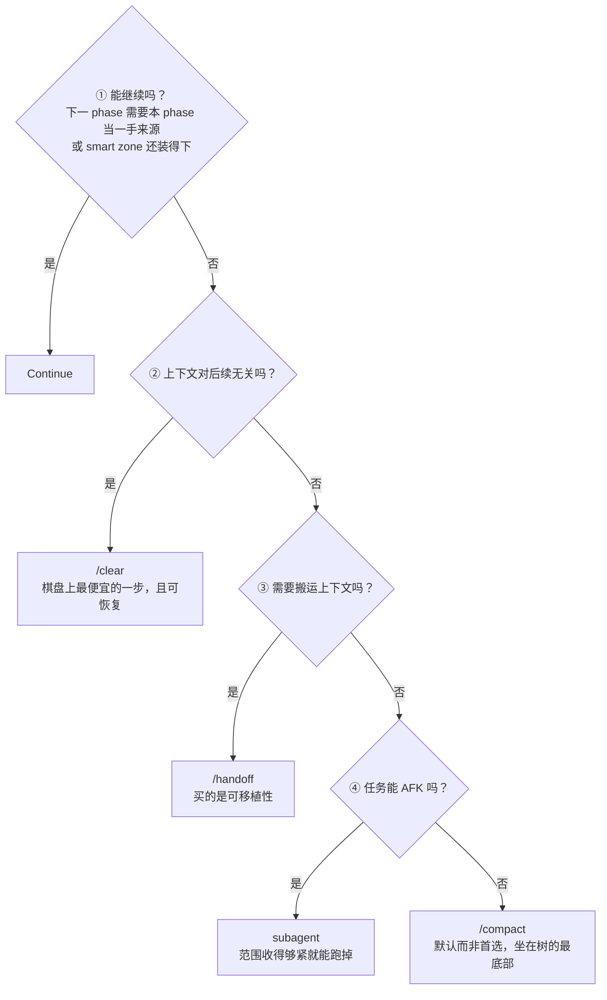

# 工作流：阶段边界

> **适用**：一个 phase（会话内的一块工作：拷问、实现、QA）结束、下一个即将开始时，上下文已经积累下来，你需要决定怎么处理它。
> **这是横向策略**：另外三个工作流里，每个 phase 之间都要过一遍这道决策树。｜返回 [推荐工作流总览](./推荐工作流.md)

---

## 核心认知

一个 **phase** 是会话内的一块工作。两个 phase 之间的**边界**，就是你决定怎么处理已积累的上下文的地方。

**只有 Continue 保留一手来源**，其余四步都把它换成有损摘要。这是整棵树的出发点。

智能区（smart zone）上限按约 **150k tokens** 估算。接近时别硬撑着降级运行，在最近的 phase 边界处理完再继续。

---

## 决策树：按序五问

---

## 五个选项详解

### ① Continue

**什么时候**：下一 phase 需要把本 phase 当**一手来源**（比如实现阶段要引用拷问阶段原话里的某个决定），或者 smart zone 还装得下。

**注意**：它是唯一保住一手资料的选项，但**第一个该排除的其实是它**，因为它让上下文继续增长，成本往后累加。

### ② `/clear`

**什么时候**：上下文对后续**无关**时。比如一个工单做完，下一个工单是全新的一屏。

**优点**：棋盘上最便宜的一步，而且**可恢复**。

**这是最被低估的选项。** 大部分"上下文快满了"的焦虑，实际答案是清掉重来，而不是想方设法搬运。

### ③ `/handoff`

**什么时候**：上下文需要**搬运**时。具体是四种情形：换 harness、换目录、交给同事、phase 中途 fork 出的支线任务。

**它买的是可移植性。没有东西在旅行，就不需要它。**

**它被高卖了。** `/handoff` 很窄，只在这四种情形用，不是上下文窗口之间的通用桥梁。

### ④ subagent

**什么时候**：任务范围收得够紧、可以 AFK 跑掉。比如一次独立的调研、一个边界清晰的实现切片。

**优点**：父会话的上下文完全不被污染，subagent 只把结论带回来。

### ⑤ `/compact`

**什么时候**：前四问都不成立时的兜底。

**它是默认而非首选**，坐在树的最底部，因为上面四问都更便宜或更精确。一上来就 compact，会得到一个**对摘要抹平的东西自信地犯错**的会话：摘要把"当时为什么这么定"的纹理抹掉了，而模型对自己的摘要毫无疑虑。

---

## 上下文卫生

**步骤 1-3 保持同一个未压缩的上下文窗口。** 具体说：`/grill-with-docs` → `/to-spec` → `/to-tickets` 这三个步骤不要中间 compact 或 clear，`/to-tickets` 之后才处理。

原因是这三步是同一个思考过程的连续展开，压缩它会丢掉决策之间的关联。

`/retro` 要在它回顾的那个会话里跑，所以它也应该在 compact **之前**完成。

---

## 快速对照

| 选项 | 买到什么 | 代价 | 典型触发 |
|---|---|---|---|
| Continue | 一手来源 | 上下文继续增长 | 下一 phase 要引用本 phase 原话 |
| `/clear` | 一个干净窗口 | 丢掉全部上下文（可恢复） | 工单做完，下一个全新 |
| `/handoff` | 可移植性 | 生成一份交接文档 | 换 harness / 换目录 / 交给同事 |
| subagent | 父窗口零污染 | 只能带回结论 | 范围紧、可 AFK |
| `/compact` | 一个有损摘要 | 纹理被抹平 | 前四问都不成立 |
