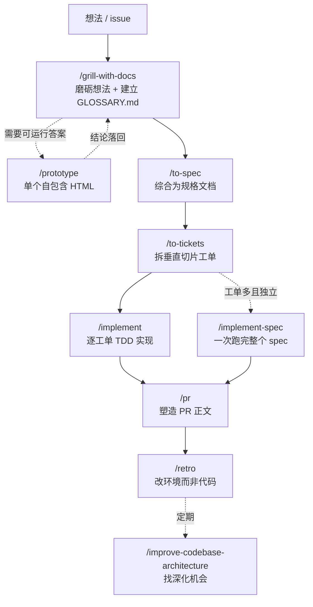

# 推荐工作流

> 使用 Matt Pocock Skills 的**主线入口**。四个工作流覆盖从想法到交付的全过程；「阶段边界」是一条**横向策略**，在其余三个工作流里随时都用得上。
>
> 配套阅读：[索引](./README.md) ｜ [逐版本差异](./上游版本差异.md) ｜ [38 个技能全文](./mattpocock-skills-中文提示词大全.md) ｜ [一页速览](./mattpocock-skills-精简版.md)

---

## 一、先选对工作流

| 你的处境 | 走哪条 | 第一个动作 |
|---|---|---|
| 一个新功能或新想法，准备动手做 | [日常开发](./工作流-日常开发.md) | `/grill-with-docs` |
| 东西坏了：报错、失败、变慢了 | [Bug 修复](./工作流-Bug修复.md) | `/diagnosing-bugs` |
| 目标庞大模糊，一个会话装不下 | [大型规划](./工作流-大型规划.md) | `/wayfinder` |
| 上下文快满了，或不知道该不该 compact | [阶段边界](./工作流-阶段边界.md) | 按决策树五问走 |
| 完全不知道该用哪个技能 | 问路由器 | `/ask-matt` |
| 别人丢来的一个 issue | 先分流，再进上面某条 | `/triage` |

> **注意入口的分工**：`/triage` 只处理**别人**创建的 issue。`/to-tickets` 产出的工单本身已是 agent-ready，别再 triage 一遍。

---

## 二、主流程全景

`idea → ship` 的主路径如下图所示。实线是必经步骤，虚线是可选或条件触发。



**三个入口匝道**可以随时插进来：

- **`/triage`**：从别人创建的 issue 进入，负责分类、验证、写代理简报。
- **`/diagnosing-bugs`**：从"坏了"进入，模型自动调用，见 [Bug 修复](./工作流-Bug修复.md)。
- **`/wayfinder`**：从庞大模糊的目标进入，先探路再回到 `/to-spec`，见 [大型规划](./工作流-大型规划.md)。

---

## 三、贯穿所有工作流的三条纪律

这三条不是某个工作流的一步，而是整套体系的做法。

### 1. 先对齐，再行动

"拷问"（grilling）是体系的灵魂：共识达成前绝不行动。每个问题都措辞成**"是"即接受推荐**，让你用一个字就能认可 agent 的建议。只有当前沿为空、且没有任何东西被默默假定时，才收尾进入行动。

### 2. 事实不问人，决策必问人

环境能查到的事实（代码怎么写的、配置项是什么、依赖什么版本）派给 subagent 去查，**不占用你的注意力**；决策权永远摆给你。这条划分决定了什么时候该问、什么时候该自己查。

### 3. 按轮次问前沿，不是一次一问

先了解决策树，把**整个前沿**（前置条件已定的全部问题）作为一轮编号问题一次问完，再从你的回答重算前沿问下一轮。同样 13 个问题约 **3 轮**就问完，而不是 13 轮。环境能回答的事实派给后台 subagent，调研不阻塞轮次。

---

## 四、四个工作流各解决什么

| 工作流 | 核心问题 | 关键产出 | 规模感 |
|---|---|---|---|
| [日常开发](./工作流-日常开发.md) | 怎么把一个想法变成合并的代码 | spec、垂直切片工单、PR | 一个功能到一次迭代 |
| [Bug 修复](./工作流-Bug修复.md) | 怎么在不瞎猜的前提下修好一个 bug | 一条红的命令、一个回归测试 | 一个 bug |
| [大型规划](./工作流-大型规划.md) | 路还看不清时怎么往前走 | 决策工单地图 | 超出单个会话 |
| [阶段边界](./工作流-阶段边界.md) | 上下文积累下来后怎么处理 | 一个干净的下一 phase | 每个 phase 之间 |

---

## 五、最短路径

如果你只想记住一条：

```text
/grill-with-docs → /to-spec → /to-tickets → /implement → /pr → /retro
```

工单多且彼此独立时，把 `/implement` 换成 `/implement-spec` 一次跑完。上下文接近 **150k tokens** 时，去 [阶段边界](./工作流-阶段边界.md) 按决策树处理，**不要硬撑着降级运行**。
